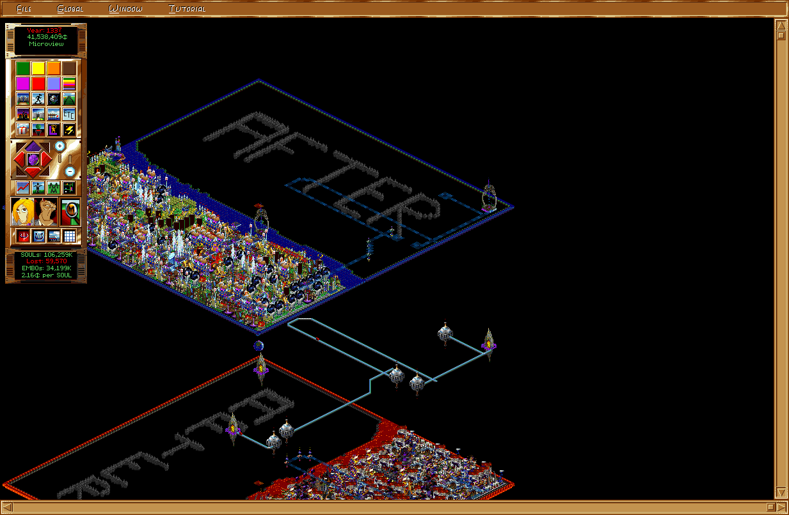

# Afterlife

A decompilation and native port of **Afterlife** (LucasArts, 1996) to portable
C11 and SDL3, for Linux, Windows, macOS and WebAssembly.

Status: **playable.** All of `ALIFE.EXE`'s game code is ported:
- the simulation, economy and SOUL flow
- building, the Karma rail network and the Bad Things
- every view window, the advisors, the news and the tutorial
- save and load, and iMUSE music and sound

The differential emulator tests check the simulation against the original.
It's a non-matching decompilation: the code behaves like the original but
doesn't compile to the same bytes. Linux is the main platform. The
WebAssembly build runs the full game in a browser. Windows and macOS build
and pass the data-less tests in CI (Windows passes the data tests under
Wine too), but nobody has played them on real Windows or a Mac yet.

**Play it in your browser:** <https://doridian.github.io/Afterlife/> (the page
asks for your CD once; see [WebAssembly](#building) below).



This repository contains **no game data files or original code** (only the
texts and number tables from `ALIFE.EXE` the port needs, as C data in the
modules that use them). The game data comes from the original CD, which a
script can download for you from the Internet Archive.

## Downloads

Each [release](https://github.com/Doridian/Afterlife/releases) has the port
as one file per system, with no game data:

| System | File |
|---|---|
| Linux (x86-64, arm64) | `afterlife-linux-x86_64.AppImage`, `afterlife-linux-arm64.AppImage` |
| Windows (x86-64) | `afterlife-windows-x86_64.exe` |
| macOS 11+ (Apple silicon and Intel) | `afterlife-macos.dmg` (the app; it isn't notarized: right-click → Open the first time) |
| Browser | `afterlife-web.zip` (the page, as published on GitHub Pages) |

Started from its icon, the port asks for the game files once: choose the
CD (or a folder with its files, such as an installed Afterlife), or an
image of the CD (`.iso`, `.bin` or `.cue`; unzip the
[archive.org download](https://archive.org/details/AfterlifeUSA) first).
An image's game files are copied into the port's settings folder, so the
image isn't needed afterwards. The choice is kept there for the next start
(`data-path.txt`; delete it to choose again). A `DATA_DIR` argument or an
`orig/` folder in the current folder or next to the executable still comes
first.

## Quick start

1. Install the build tools:
   - **Arch / CachyOS**: `sudo pacman -S base-devel cmake ninja sdl3 python`
   - **Debian 13 / Ubuntu 25.04 or newer**: `sudo apt install build-essential cmake ninja-build python3 libsdl3-dev`
     (on older releases leave out `libsdl3-dev`: the build fetches SDL3 and
     compiles it, which needs [SDL's build dependencies](https://wiki.libsdl.org/SDL3/README-linux))
   - **Fedora**: `sudo dnf install gcc cmake ninja-build SDL3-devel python3`
   - **macOS**: `brew install cmake ninja sdl3`
2. Get the code and the game data, then build and play:

   ```sh
   git clone https://github.com/Doridian/Afterlife
   cd Afterlife
   tools/fetch_archive_org.py orig/
   cmake --preset native
   cmake --build --preset native
   build/native/afterlife
   ```

The fetch step downloads 167 MB once and puts the game files in `orig/`,
where the port finds them on its own. The port starts with its bug fixes
and UI scaling for big screens on; **Global → Port Options...** in the game
turns them off for the original's exact behaviour (see
[Enhancements](#enhancements)).

## Getting the game data

`tools/fetch_archive_org.py orig/` downloads the US CD (a Redump BIN/CUE) from
<https://archive.org/details/AfterlifeUSA> and extracts it. It checks the
download's SHA-1 and the extracted files against
[docs/binaries.md](docs/binaries.md). `--keep-zip FILE` keeps the zip, and
`--zip FILE` uses one you already have.

If you have your own BIN/CUE (or ISO) image of the CD:

```sh
tools/extract_cd.py /path/to/Afterlife.cue orig/
```

This writes the CD's files to `orig/` (gitignored) and prints their SHA-256s.
Compare them against [docs/binaries.md](docs/binaries.md). Only the
Windows 95 release has been checked so far.

At runtime the port needs the data files: the `.000` bundles (`ALIFE.000`,
`MEDIUM.000`, `FULL.000`), `ALIFE.INI`, the scenarios (`ASCEN*.ASC`) and
`ALIFE.EXE`, which it reads for its image data: the cursors, the icon and the
built-in font. The texts, number tables and credits the EXE carries are part
of the source, so building doesn't need the EXE.

## Building

Requires CMake ≥ 3.24, Ninja, a C11 compiler and SDL3 (fetched automatically if
not installed).

```sh
cmake --preset native
cmake --build --preset native
build/native/afterlife orig/
```

There's also a `debug` preset with ASan/UBSan.

**macOS**: `brew install cmake ninja sdl3`, then the same commands. Without
a `DATA_DIR` argument the port looks for `orig/` in the current folder, then
next to the executable, then asks (see [Downloads](#downloads)). Ctrl+Cmd+F toggles fullscreen and Cmd+Q asks before
quitting. On a Retina screen the automatic UI scale (an enhancement) keeps
the game readable; with the enhancements off it draws at native pixels and
looks small.

**Windows**: in [MSYS2](https://www.msys2.org/)'s CLANG64 shell,
`pacman -S mingw-w64-clang-x86_64-clang mingw-w64-clang-x86_64-cmake mingw-w64-clang-x86_64-ninja git`,
then the same commands; the build fetches SDL3 and links it in, so
`build/native/afterlife.exe` runs on its own. Cross-building from Linux with
[llvm-mingw](https://github.com/mstorsjo/llvm-mingw) works too, and `ctest`
runs the tests under Wine with `-DCMAKE_CROSSCOMPILING_EMULATOR=wine`.

`-DAFTERLIFE_STATIC_SDL=ON` fetches SDL3 and links it in even when one is
installed (the release packages are built that way).

**WebAssembly** (Emscripten, [docs/web.md](docs/web.md)):

```sh
emcmake cmake --preset wasm -DAFTERLIFE_WASM_DATA=$PWD/orig
cmake --build --preset wasm
cd build/wasm && python3 -m http.server 8000   # http://localhost:8000/afterlife.html
```

The same build without data is published at <https://doridian.github.io/Afterlife/>:
the page asks for the CD image, which is on [archive.org](https://archive.org/details/AfterlifeUSA).

`AFTERLIFE_WASM_DATA` builds the game files the port needs into
`afterlife.data` (about 150 MB with the CD's `ALIFE.INI`). Don't publish such
a build. Without it the page asks for the files once and keeps them in the
browser. Saves and the port settings are kept in the browser too
(IndexedDB). Dropping a `.alf` or `.asc` onto the page loads it, and
File > Save to Download / Download Saved Game save to your computer. The
canvas follows the browser window. Alt+Enter or F11 toggles
fullscreen. `?arg=...` in the URL passes command-line options.

CI (`.github/workflows/build.yml`) builds on Linux, macOS and Windows, runs
the tests that need no game data, builds the WebAssembly target and the
packages of [Downloads](#downloads). A `v*` tag publishes the packages on
the tag's release.

## Running

```
afterlife [DATA_DIR] [FILE.INI] [SAVE.ALF|SCENARIO.ASC] [options]
```

The port opens in a resizable window that remembers its size and position.
**Alt+Enter** or **F11** toggles fullscreen.

| Option | |
|---|---|
| `--enhancements` / `--no-enhancements` | turn the enhancements on (the default) or off |
| `--ui-scale=N` | UI scale, `0` = auto, `1`–`4` (enhancements only) |
| `--window-size=WxH` | starting window size |
| `--fullscreen` / `--windowed` | start fullscreen or windowed |
| `--port-ini=FILE` | use another port settings file |
| `--debug-window` | open the original's hidden debug window (a tile browser, [docs/ui.md](docs/ui.md#debug-window)) |

### Enhancements

By default the port runs with its *enhancements* on: fixes for the
original's bugs (two hangs among them) and an integer UI scale, so the 1996
interface stays usable on high-resolution screens.
[docs/enhancements.md](docs/enhancements.md) lists them all. **Global → Port
Options...** (or `--no-enhancements`) turns them off, and the port then
behaves like the original, bugs included.

The port keeps its own settings in `ALIFEPORT.INI` in the SDL preferences
folder (`~/.local/share/Afterlife/Afterlife/` on Linux,
`%APPDATA%\Afterlife\Afterlife\` on Windows,
`~/Library/Application Support/Afterlife/Afterlife/` on macOS, IndexedDB in
the browser), so the original's `ALIFE.INI` stays untouched.

## Tests

```sh
cmake --preset native -DAFTERLIFE_DATA=$PWD/orig
cmake --build --preset native
ctest --test-dir build/native
```

Without `AFTERLIFE_DATA`, only the tests that need no game data run.

`tools/emu/` runs the original `ALIFE.EXE`'s functions in a Unicorn emulator
side by side with the port, on real saves, and compares state and RNG. See
[tools/emu/README.md](tools/emu/README.md).

## Tools

- `tools/fetch_archive_org.py`: downloads the CD from archive.org and extracts it.
- `tools/extract_cd.py`: pure-Python ISO9660 extractor for BIN/CUE and ISO images.
- `tools/jiff.py`: list, summarise or dump the resources in the `.000` bundles.
- `tools/gh`, `tools/ghidra/`: headless Ghidra setup and scripts for the decompilation.
- `tools/emu/`: the differential emulator tests.

## Docs

- [docs/decomp-workflow.md](docs/decomp-workflow.md): approach, Ghidra setup, layout, conventions
- [docs/game-map.md](docs/game-map.md): module map of the game and the port
- [docs/binaries.md](docs/binaries.md): what's on the CD and what the executables are built with
- [docs/startup.md](docs/startup.md), [docs/rendering.md](docs/rendering.md),
  [docs/ui.md](docs/ui.md), [docs/map.md](docs/map.md),
  [docs/imuse.md](docs/imuse.md), [docs/compbun.md](docs/compbun.md):
  subsystem notes
- [docs/web.md](docs/web.md): the WebAssembly build
- [docs/enhancements.md](docs/enhancements.md): what the enhancements flag changes
- [docs/formats/](docs/formats/): file formats (JIFF bundles, compression,
  FLC, TILE, AKOS, ALSV saves)

## Legal

Afterlife is © LucasArts Entertainment Company. This project is not affiliated
with or endorsed by LucasArts or Disney. It's intended for owners of the
original game, for preservation and interoperability.

The code in this repository is licensed under the
[GNU Affero General Public License v3.0 or later](LICENSE). Game data is not
included and is not covered by this license
